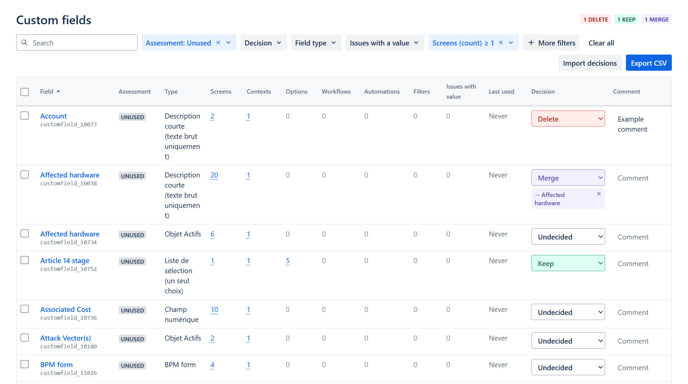
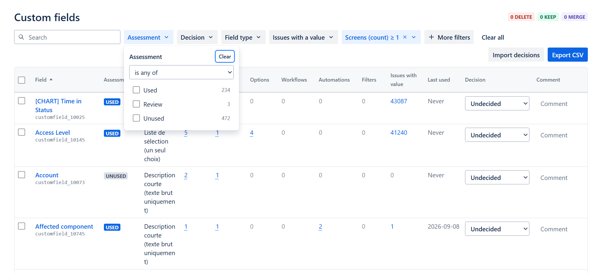
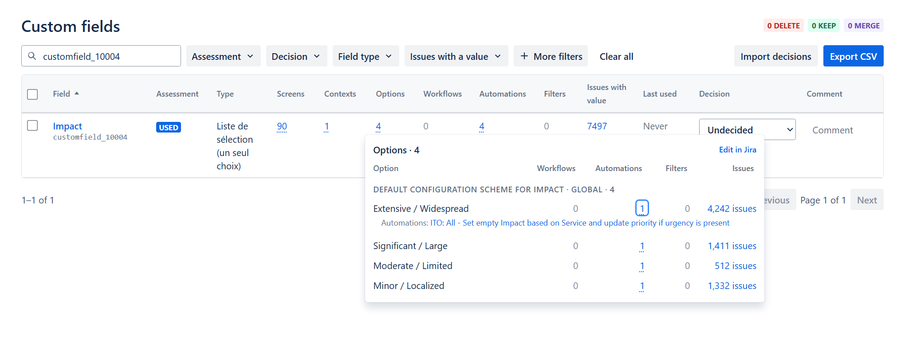
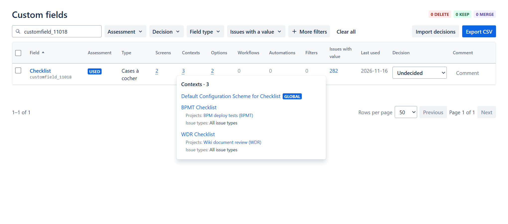

# Jira custom field review

One Python script that scans **every custom field** on a Jira Cloud site and writes a single,
self-contained HTML report you can search, filter and annotate, to help decide which fields to
delete, keep or merge.

It is **read-only**: it never changes anything in Jira, and your API token is kept in memory only.



*The report: one row per custom field. The decision and comment columns are for your own review
(the decisions shown here are examples).*

## Quick start

```bash
python jira_custom_fields_review.py
```

1. Enter your site (`mycompany.atlassian.net`, or just `mycompany`), your email and an API token.
2. The script checks access and scans your site (about 5 minutes for ~800 fields).
3. Open the generated `custom-fields-review-<site>-<date>.html` in any browser. No server needed.

## What you get

For each custom field:

| Column | Meaning |
|---|---|
| **Assessment** | **Used**: issues hold a value, or a filter / workflow / automation rule references it. **Review**: no data and no references, but Jira has a last-used date. **Unused**: none of the above. |
| **Screens** | The screens the field is on, linked to Jira. |
| **Contexts** | Every context (global and per project / issue type), linked to Jira. |
| **Options** | For select lists, radio buttons, checkboxes and cascading fields: each option with its **issue count** and the **workflows, automation rules and filters** that name it. |
| **Workflows / Automations / Filters** | Where the field is referenced, each item linked to Jira. |
| **Issues with value** | How many issues have a value. Click to open them in Jira search. |
| **Last used** | Date reported by Jira. |
| **Decision / Comment** | Your own review: Delete, Keep or Merge (with a merge target), plus a note. |

### Search and filter like in Jira

A search box plus filter chips for assessment, decision, field type and issue count, and a
**More filters** menu with the rest (screens, contexts, projects, workflows, automations, saved
filters, options, last used, name, ID, description, comment). Each filter uses the operators that
make sense for its type: *is any of / all of / none of* for lists, *= ≠ > ≥ < ≤ between* for numbers,
*contains / starts with / is empty* for text, and a calendar for dates.



### Options, with issue counts and usage

Click the number in the **Options** column to see every option per context, how many issues hold it,
and which workflows, automations and filters use it. Click a usage count to list them as links.



### Contexts

Click the number in the **Contexts** column to see every context of the field, its projects and its
issue types.



### Decisions

Choose **Delete**, **Keep** or **Merge** per field (for Merge, pick the field to merge into) and add a
comment. The counters at the top right summarise your decisions, and a **N incomplete** badge appears
for merges that have no target yet. Click a counter to filter by it. Decisions are saved in your
browser only; **Export CSV** to share them, and **Import decisions** to load them back.

## Requirements

- Python 3.8 or newer. No packages to install.
- A Jira Cloud site, and an account that is a **Jira administrator** (needed to read field
  contexts and screens).
- An API token: <https://id.atlassian.com/manage-profile/security/api-tokens>

## Options

| Option | Meaning |
|---|---|
| `--workers N` | Parallel requests (default 8). Lower it if Jira rate-limits you. |
| `--out FILE` | Output file (default `custom-fields-review-<site>-<date>.html`). |

You can also set `JIRA_URL`, `JIRA_EMAIL` and `JIRA_TOKEN` as environment variables to skip the prompts.

## How it works

The script runs six stages and shows a progress bar for each: check access, load site data (fields,
projects, filters, workflows, automation rules), scan every field (contexts, screens, issue count,
options), count issues per option, find where fields are used, and write the report. Requests run in
parallel and are retried automatically when Jira rate-limits them.

## What it reads

Only read endpoints of the Jira Cloud REST API: fields, contexts, options, screens, projects, filters,
workflows, issue types, plus the read-only issue-count search. Automation rules are read through
Atlassian's automation API with the same account. If that is not allowed, the script says so and
automation rules are not counted as usage.

## Limits: read before deleting anything

"Unused" is **evidence, not proof**.

- Counts only include issues **the scanning account can see**. Projects it cannot browse, archived
  projects and issues hidden by issue security are not counted. Use an account that can see everything.
- Issue counts come from Jira's approximate count.
- References are found by text matching: a field is matched by id (`cf[123]`, `customfield_123`) or by
  its quoted name (a type hint such as `"Name[Number]"` is handled). Usage in places the script does not
  read (dashboards, boards, forms, apps) is not seen.
- Team-managed project fields and system fields are not covered.
- Jira Cloud only. Jira Data Center uses different APIs.

Always check a field in Jira (the report links to it) before removing it.

## License

MIT, see [LICENSE](LICENSE).
